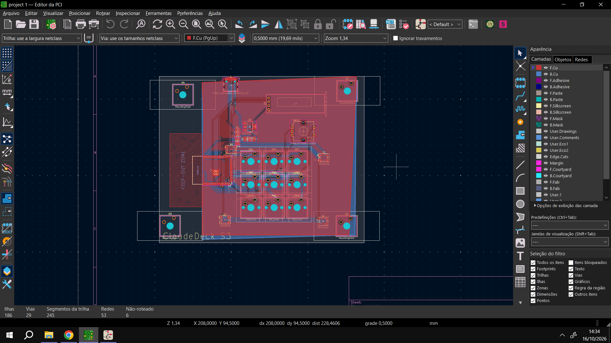
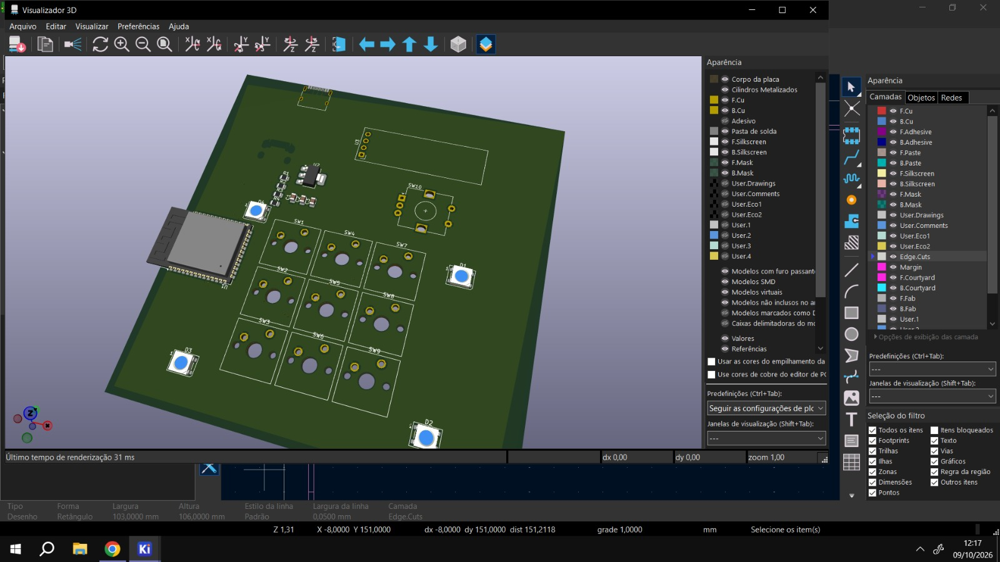

# ClaudeDeck S3


A custom 3x3 mechanical macropad powered by the ESP32-S3, featuring a 0.91" OLED display and per-key RGB lighting.

## Project Structure

```text
ClaudeDeck-S3/
├── CAD/
│   ├── BOM.csv
│   ├── README.md
│   └── enclosure/
├── PCB/
│   ├── BOM.csv
│   ├── ClaudeDeck-S3.kicad_pcb
│   ├── ClaudeDeck-S3.kicad_sch
│   ├── README.md
│   └── gerbers/
├── docs/
│   ├── project-journal.md
│   ├── schematic.png
│   ├── pcb_layout.png
│   ├── 3D case top view.jpeg
│   └── bottom view of 3D case.jpeg
└── firmware/
```

## Why and How I Made It

I built the ClaudeDeck S3 because I needed a dedicated, programmable hardware interface to speed up my workflow in CAD software (like Fusion 360) and programming IDEs. I wanted something fully customizable, from the mechanical feel of the switches to the macros executed by the ESP32-S3.

## Features

- **Microcontroller:** ESP32-S3-WROOM-1 with Wi-Fi and Bluetooth capabilities.
- **Switches:** 3x3 matrix (9 keys) compatible with standard Cherry MX mechanical switches.
- **Display:** 0.91" I2C OLED screen for real-time status, menus, and feedback.
- **Lighting:** WS2812B RGB LEDs under each switch.
- **Connectivity:** USB-C.

## Electronics and PCB Design

The schematic and PCB layout were designed in KiCad.




PCB source files, fabrication outputs, and electronics BOM are in [`PCB/`](PCB/README.md).

## Mechanical and Enclosure Design

The enclosure was modeled in Autodesk Fusion 360, including the angled case profile, mounting structure, and print-fit clearances.

**Top View (Ergonomic Wedge):**


**Bottom View (Debossed Logo & Feet Cavities):**


CAD files and enclosure hardware BOM are in [`CAD/`](CAD/README.md).

## Bill of Materials

- **Electronics / PCB BOM:** [`PCB/BOM.csv`](PCB/BOM.csv)

- **Enclosure / 3D Printing BOM:** [`CAD/BOM.csv`](CAD/BOM.csv)
- ## Bill of Materials (BOM)

| Item | Quantity | Unit Price | Total Price | Link |
| :--- | :---: | :---: | :---: | :--- |
| **M3 Heat-Set Inserts** | 1 | $2.00 | $2.00 | [View Item](https://lista.mercadolivre.com.br/inserto-roscado-m3) |
| **M3x6mm Screws** | 1 | $2.00 | $2.00 | [View Item](https://lista.mercadolivre.com.br/parafuso-m3x6) |
| **10mm Silicone Rubber Feet (Bumpons)** | 1 | $3.00 | $3.00 | [View Item](https://lista.mercadolivre.com.br/gota-silicone-adesiva-10mm) |
| **PLA / PETG Filament (1Kg)** | 1 | $15.00 | $15.00 | [View Item](https://www.mercadolivre.com.br/filamento-pla-preto-1kg-voolt3d-175mm-premium-para-imprimir-pecas-3d-impressao-3d-cor-preta-modelagem-miniaturas-enfeites-e-projetos-em-impressoras-3d/p/MLB26212091) |
| **Estimated total shipping** | 1 | $0.00 | $0.00 | - |

## Project Journal

Development history and dated enclosure design entries are in [`docs/project-journal.md`](docs/project-journal.md).
